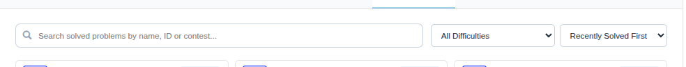
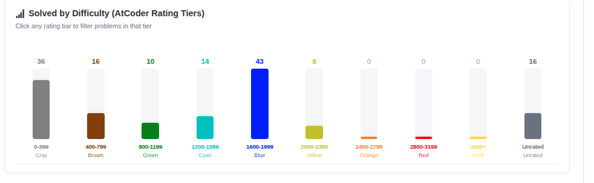

# ⚡ AtCoder Pulse

> **A modern, lightweight Manifest V3 browser extension for competitive programmers.**  
> Enhances your AtCoder profile pages with interactive analytics, Codeforces-style activity heatmaps, 200-rating interval distributions, and an instant unsolved backlog tracker.

---

## 🌟 About the Extension

**AtCoder Pulse** is designed to give AtCoder competitors the same deep analytics and practice tracking experience familiar to platforms like Codeforces and LeetCode, injected seamlessly directly into `https://atcoder.jp/users/*` profile pages.

### Why AtCoder Pulse?
- 📅 **Practice Consistency**: Visualizes your daily solves over a 53-week rolling heatmap with streak tracking.
- 🎯 **Targeted Training**: Identifies your rating strengths and weaknesses across 18 granular 200-point rating intervals.
- 🔥 **No Problem Left Behind**: Compact unsolved backlog tracks every problem you attempted with WA/TLE and reminds you to upsolve it.
- ⚡ **Zero Crawl Delay**: Unlike traditional Kenkoooo tools that lag 5–15 minutes, AtCoder Pulse scrapes AtCoder's own submission page directly on sync for **instant AC detection**!
- 🪶 **Lightweight & Private**: 100% client-side, zero external telemetry, zero tracking, runs locally on your browser.

---

## 🛠️ How to Install & Use Locally (ZIP File)

You can install and use AtCoder Pulse in under 1 minute on any Chromium-based browser (**Chrome, Brave, Edge, Opera, Vivaldi**) or **Mozilla Firefox**.

### 1. Chromium Browsers (Google Chrome, Brave, Microsoft Edge)

1. **Get the files**:
   - Download or locate the [`atcoder-pulse-extension.zip`](atcoder-pulse-extension.zip) file from this repository.
   - Extract (unzip) the zip file into a folder on your computer.
2. **Open Extensions page**:
   - Chrome: `chrome://extensions`
   - Brave: `brave://extensions`
   - Edge: `edge://extensions`
3. **Enable Developer Mode**:
   - Toggle the **Developer mode** switch in the top-right corner.
4. **Load the Extension**:
   - Click the **Load unpacked** button in the top-left corner.
   - Select the extracted folder containing `manifest.json`.
5. **Start Using**:
   - Open any AtCoder profile (e.g. `https://atcoder.jp/users/chokudai` or your profile).
   - You will see the **AtCoder Pulse** analytics interface directly integrated into the page!

---

### 2. Mozilla Firefox

1. Open Firefox and navigate to:
   ```
   about:debugging#/runtime/this-firefox
   ```
2. Click **Load Temporary Add-on...**
3. Select the `manifest.json` file inside the extracted folder (or the `.zip` file).
4. The extension will be active immediately.

---

## ✨ Features & Screenshots

### 1. 📅 Activity Heatmap & Streaks (Codeforces-Style)
Track your daily practice habits over a 53-week GitHub/Codeforces-style calendar. Automatically scrolls to the current date so your latest updates are always front and center.


- **6 Key Practice Metrics**: Solved all time, solved last year, solved last month, and max consecutive active days (all time, last year, and current streak).
- **Accurate Local Time**: Dates use your browser's local timezone (no UTC drift).

---

### 2. 📊 Solved by Difficulty (200-Rating Intervals)
Visualizes your problem distribution across 18 granular 200-rating intervals (`0-199`, `200-399` ... `3000-3199`, `3200+`, and `Unrated`) using AtCoder's official tier colors.


- **Interactive Filtering**: Click any bar to instantly filter the Solved List to show only problems in that rating range!

---

### 3. 🔍 Search, Task (A–Ex) Filtering & Multi-Criteria Sorting
Full control over your solved and unsolved problem lists with live search, dedicated task selectors, and flexible sorting.



- **Task Index Selector**: Filter directly by `Task A`, `Task B`, `Task C`, `Task D`, `Task E`, `Task F`, `Task G`, `Task Ex`, or `Other`.
- **Multi-Criteria Sorting**:
  - `Recently Solved First` (or Recently Attempted)
  - `Task: A to Ex` (A ➔ B ➔ C ... ➔ Ex)
  - `Task: Ex to A`
  - `Difficulty: High to Low`
  - `Difficulty: Low to High`
  - `Oldest Solved First`

---

### 4. 🔥 Compact Solved & Unsolved Backlog Lists
Quickly review past attempts and see problems that still need an Accepted verdict.



- **At-a-Glance Badges**: Difficulty rating pill, attempt count, failed verdicts, time ago, and contest tag.
- **⚡ 1st-Try AC Detection**: Highlights whether a problem was solved on the first submission or required retries.
- **One-Click Links**: Jump straight into the task statement or review past submissions.

---

### 5. ⚡ Instant Sync & Smart Caching
- **Instant Local Cache**: Renders immediately on page load from IndexedDB without waiting for network requests.
- **Direct AtCoder Scraping**: Bypasses Kenkoooo crawl delays by fetching your recent submissions directly from AtCoder for real-time AC updates.
- **24-Hour Metadata TTL**: Problem models and contest indexes are cached locally to minimize network traffic.

---

### 6. 🌙 Dark & Light Themes
Switch between dark and light modes with a single click using the theme toggle button in the header.

---

## 📂 Project Structure

```
├── manifest.json                  # Manifest V3 browser configuration
├── package.py                     # Script to package atcoder-pulse-extension.zip
├── atcoder-pulse-extension.zip    # Ready-to-use distribution archive
├── screenshots/                   # Feature screenshots for documentation
│   ├── activity-heatmap.png
│   ├── difficulty-distribution.png
│   ├── search-filter-sorting.png
│   └── solved-unsolved-list.png
├── icons/                         # 16, 32, 48, 128px extension icons
├── popup/                         # Toolbar quick-view popup (HTML/CSS/JS)
├── content/                       # Injected dashboard scripts & styles
│   ├── content.js                 # DOM injection & tab management
│   ├── dashboard.js               # Reactive dashboard components
│   └── content.css                # Themes & responsive styling
├── background/                    # Service worker for background network bridge
│   └── service_worker.js
└── utils/                         # Core analytics & storage modules
    ├── api.js                     # Direct AtCoder scraper & Kenkoooo fallback
    ├── analyzer.js                # Solves, streaks, and rating algorithms
    ├── charts.js                  # Native SVG chart renderers
    ├── colors.js                  # 200-rating intervals & AtCoder colors
    └── db.js                      # IndexedDB local storage layer
```

---

## 📦 How to Rebuild the Extension ZIP

If you make any changes to the code, simply run:

```bash
python3 package.py
```

This will automatically validate file integrity and create a fresh `atcoder-pulse-extension.zip`.

---

## 🔒 Privacy & Permissions

- **Permissions Used**:
  - `storage` / `unlimitedStorage`: Caches your submissions and difficulty ratings locally in IndexedDB.
  - `host_permissions` (`https://atcoder.jp/*`, `https://kenkoooo.com/*`): Injects the dashboard into AtCoder profile pages and downloads problem difficulty models.
- **No Remote Code**: 100% compliant with Manifest V3 CSP. All scripts are bundled locally.
- **Zero Tracking**: Your data never leaves your browser.

---

## 📄 License

MIT License. Created by [Md-DinIslam](https://github.com/Md-DinIslam).
