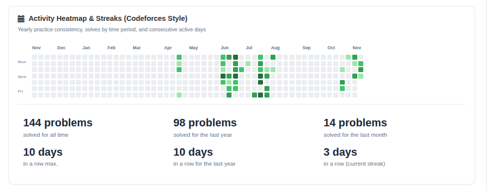
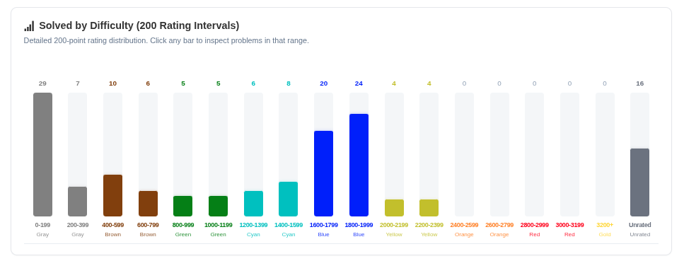
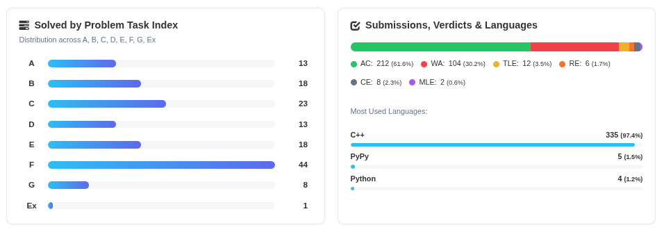
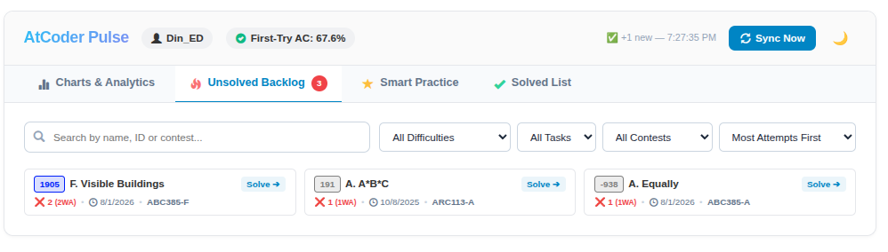
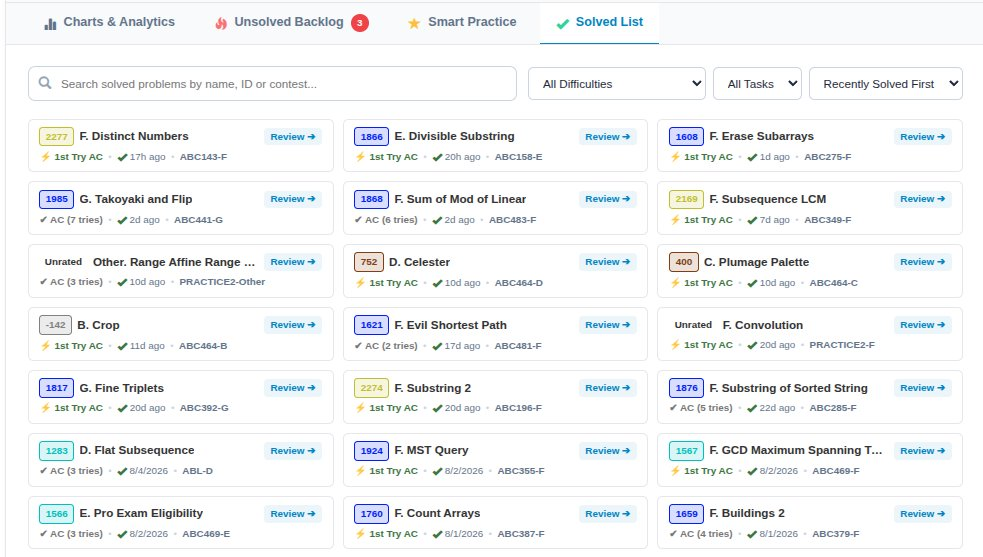
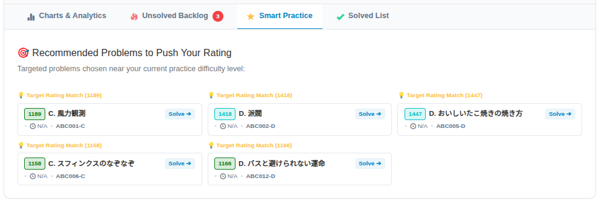
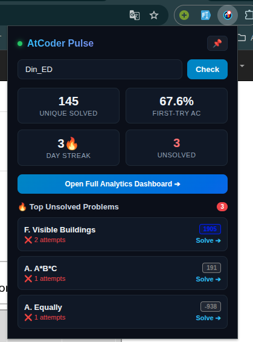

# ⚡ AtCoder Pulse

> **A modern, lightweight Manifest V3 browser extension for competitive programmers.**  
> Enhances your AtCoder profile pages with interactive analytics, Codeforces-style activity heatmaps, 200-rating interval distributions, and an instant unsolved backlog tracker.

---

## 🌟 About the Extension

**AtCoder Pulse** is designed to give AtCoder competitors the same deep analytics and practice tracking experience familiar to platforms like Codeforces and LeetCode, injected seamlessly directly into `https://atcoder.jp/users/*` profile pages.

### Why AtCoder Pulse?
- 📅 **Practice Consistency**: Visualizes your daily solves over a 53-week rolling heatmap with streak tracking.
- 🎯 **Targeted Training**: Identifies your rating strengths and weaknesses across 18 granular 200-point rating intervals.
- 🔥 **No Problem Left Behind**: Compact unsolved backlog tracks every problem you attempted with WA/TLE and reminds you to upsolve it.
- ⚡ **Zero Crawl Delay**: Unlike traditional Kenkoooo tools that lag 5–15 minutes, AtCoder Pulse scrapes AtCoder's own submission page directly on sync for **instant AC detection**!
- 🪶 **Lightweight & Private**: 100% client-side, zero external telemetry, zero tracking, runs locally on your browser.

---

## 🛠️ How to Install & Use Locally (ZIP File)

You can install and use AtCoder Pulse in under 1 minute on any Chromium-based browser (**Chrome, Brave, Edge, Opera, Vivaldi**) or **Mozilla Firefox**.

### 1. Chromium Browsers (Google Chrome, Brave, Microsoft Edge)

1. **Get the files**:
   - Download or locate the [`atcoder-pulse-extension.zip`](atcoder-pulse-extension.zip) file from this repository.
   - Extract (unzip) the zip file into a folder on your computer.
2. **Open Extensions page**:
   - Chrome: `chrome://extensions`
   - Brave: `brave://extensions`
   - Edge: `edge://extensions`
3. **Enable Developer Mode**:
   - Toggle the **Developer mode** switch in the top-right corner.
4. **Load the Extension**:
   - Click the **Load unpacked** button in the top-left corner.
   - Select the extracted folder containing `manifest.json`.
5. **Start Using**:
   - Open any AtCoder profile (e.g. `https://atcoder.jp/users/chokudai` or your profile).
   - You will see the **AtCoder Pulse** analytics interface directly integrated into the page!

---

### 2. Mozilla Firefox

1. Open Firefox and navigate to:
   ```
   about:debugging#/runtime/this-firefox
   ```
2. Click **Load Temporary Add-on...**
3. Select the `manifest.json` file inside the extracted folder (or the `.zip` file).
4. The extension will be active immediately.

---

## ✨ Features & Screenshots

### 1. 📅 Activity Heatmap & Streaks (Row 1)
Track your practice consistency over a 53-week GitHub/Codeforces-style calendar. The scrollbar automatically defaults to the rightmost edge so your latest solve updates are instantly visible.



- **6 Key Practice Metrics**: Solved all time, solved last year, solved last month, and max consecutive active days (all time, last year, and current streak).
- **Accurate Local Time**: Dates use your browser's local timezone (no UTC drift).

---

### 2. 📊 Solved by Difficulty (200-Rating Intervals) (Row 2)
Visualizes your problem distribution across 18 granular 200-rating intervals (`0-199`, `200-399` ... `3000-3199`, `3200+`, and `Unrated`) using AtCoder's official tier colors.



- **Interactive Filtering**: Click any bar to instantly filter the Solved List to inspect problems in that rating range!
- **Accurate 0-Count Handling**: Clean tracks without misleading colored stubs for intervals with zero solves.

---

### 3. 📋 Problem Task Index & Submission Analytics (Row 3)
A dual-panel breakdown providing actionable insights into your contest problem tendencies and coding language preferences.



- **Task Index Breakdown (A, B, C, D, E, F, G, Ex)**: Shows your solve counts across every task letter. Click any task row to view solved problems for that task!
- **Verdicts Progress Bar**: Color-coded segmented bar for AC, WA, TLE, RE, CE, and MLE verdicts.
- **Language Statistics**: Accurate percentage breakdown of your most-used programming languages (C++, PyPy, Python, Rust, etc.).

---

### 4. 🔥 Header & Unsolved Backlog Tracker
Stay on top of problems you've attempted but haven't solved yet.



- **Real-Time Header Sync**: Shows instant status updates (`✅ +1 new`), First-Try AC accuracy pill (`67.6%`), one-click **Sync Now**, and Dark/Light theme toggle.
- **Unsolved Problem Cards**: Shows attempt count, exact failed verdicts (`❌ 2 (2WA)`), contest tag, and direct **Solve ➔** button to jump into the task.
- **Filters**: Filter by Difficulty, Task (A–Ex), Contest type (ABC/ARC/AGC/Other), or sort by Most Attempts or Recently Attempted.

---

### 5. ✅ Solved List with Task (A–Ex) Filtering, Multi-Criteria Sorting & Pagination
Explore your full history of solved problems with live search, rating tiers, and task filters.



- **Live Search & Filter**: Search by problem title, ID, contest, or filter by exact rating intervals and task letters (`Task A`, `Task B` ... `Task Ex`).
- **Clean 30-Problem Pagination**: Displays 30 problems per page with `« Prev` and `Next »` controls and direct page jumping, ensuring blazing-fast DOM performance.
- **Comprehensive Sorting**:
  - `Recently Solved First` (Default)
  - `Task: A to Ex` (A ➔ B ➔ C ... ➔ Ex)
  - `Task: Ex to A`
  - `Difficulty: High to Low`
  - `Difficulty: Low to High`
  - `Oldest Solved First`
- **First-Try AC Badges**: Highlights problems solved on the very first try (`⚡ 1st Try AC`) versus problems that required retries (`✔ AC (3 tries)`).

---

### 6. 🎯 Smart Practice Recommendations
Targeted problem suggestions chosen near your current practice difficulty level to help push your rating higher.



- **Adaptive Rating Match**: Dynamically recommends problems tailored to your median solving strength.
- **Direct Solve Links**: 1-click links to jump directly to the problem statement.

---

### 7. 📌 Browser Toolbar Quick-Action Popup
Access your essential practice metrics and top unsolved problems directly from your browser toolbar at any time without leaving your current tab.

<p align="center">
  
</p>

- **At-A-Glance Stats**: Unique Solved count, First-Try AC percentage, active Day Streak, and current Unsolved backlog.
- **Top Unsolved Shortcuts**: Instantly jump into problems you recently failed with direct **Solve ➔** links and difficulty badges.
- **One-Click Dashboard Access**: Click **Open Full Analytics Dashboard ➔** to immediately navigate to your profile analytics.

---

### 8. ⚡ Real-Time Instant Sync & Smart Caching
- **Instant Local Cache**: Renders immediately on page load from IndexedDB without waiting for network requests.
- **Silent Real-Time Tracker (`submission_tracker.js`)**: Captures submissions the exact moment they are judged on AtCoder, updating open dashboard tabs in real time without waiting for external API crawlers.
- **24-Hour Metadata TTL**: Problem models and contest indexes are cached locally to minimize network traffic.

---

## 📂 Project Structure

```
├── manifest.json                  # Manifest V3 browser configuration
├── package.py                     # Script to package atcoder-pulse-extension.zip
├── atcoder-pulse-extension.zip    # Ready-to-use distribution archive
├── screenshots/                   # Feature screenshots for documentation
│   ├── activity-heatmap.png
│   ├── difficulty-distribution.png
│   ├── task-index-and-verdicts.png
│   ├── unsolved-backlog.png
│   ├── solved-list.png
│   ├── smart-practice.png
│   └── extension-popup.png
├── icons/                         # 16, 32, 48, 128px extension icons
├── popup/                         # Toolbar quick-view popup (HTML/CSS/JS)
├── content/                       # Injected dashboard scripts & styles
│   ├── content.js                 # DOM injection & tab management
│   ├── dashboard.js               # Reactive dashboard components
│   ├── submission_tracker.js      # Silent real-time submission listener
│   └── content.css                # Themes & responsive styling
├── background/                    # Service worker for background network bridge
│   └── service_worker.js
└── utils/                         # Core analytics & storage modules
    ├── api.js                     # Kenkoooo incremental sync & caching
    ├── analyzer.js                # Solves, streaks, and rating algorithms
    ├── charts.js                  # Native SVG chart renderers
    ├── colors.js                  # 200-rating intervals & AtCoder colors
    └── db.js                      # IndexedDB local storage layer
```

---

## 📦 How to Rebuild the Extension ZIP

If you make any changes to the code, simply run:

```bash
python3 package.py
```

This will automatically validate file integrity and create a fresh `atcoder-pulse-extension.zip`.

---

## 🔒 Privacy & Permissions

- **Permissions Used**:
  - `storage` / `unlimitedStorage`: Caches your submissions and difficulty ratings locally in IndexedDB.
  - `host_permissions` (`https://atcoder.jp/*`, `https://kenkoooo.com/*`): Injects the dashboard into AtCoder profile pages and downloads problem difficulty models.
- **No Remote Code**: 100% compliant with Manifest V3 CSP. All scripts are bundled locally.
- **Zero Tracking**: Your data never leaves your browser.

---

## 📄 License

MIT License. Created by [Md-DinIslam](https://github.com/Md-DinIslam).
